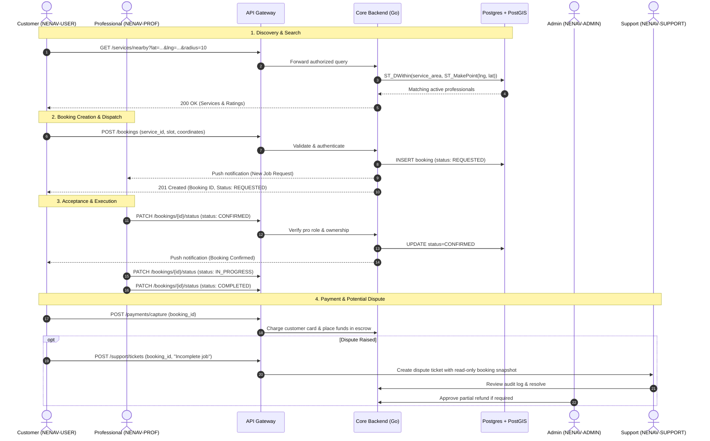

# NENAV — End-to-End Architecture & Core Lifecycles

This document describes the end-to-end data flow for the primary user journey in NENAV: service discovery, booking dispatch, execution, payment settlement, dispute escalation, and admin audit.

---

## 1. End-to-End Booking Lifecycle

---

## 2. Invariant Rules Across the Ecosystem

1. **No Client Trust:** Booking amounts, platform fees, and pro earnings are calculated server-side only.
2. **Deterministic State Transitions:** Bookings cannot transition backwards or skip mandatory checkpoints (e.g. `REQUESTED` $\rightarrow$ `CONFIRMED` $\rightarrow$ `IN_PROGRESS` $\rightarrow$ `COMPLETED`).
3. **Escrow Hold:** Customer funds are captured into escrow upon booking confirmation and released to the professional's payout balance only upon successful OTP/job completion or verified resolution.
