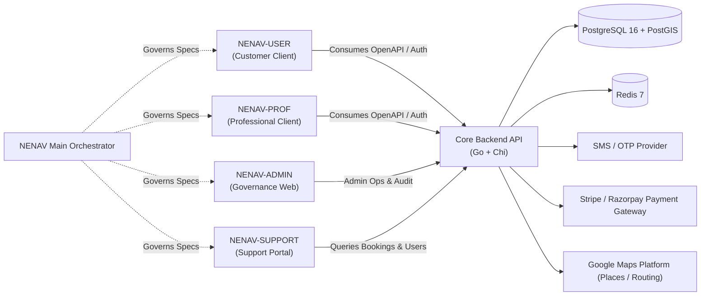

# NENAV Ecosystem — Dependency & Integration Map

This matrix documents the service boundaries, data dependencies, and cross-repository integration interfaces across the ecosystem.

---

## Service Contracts & Dependency Invariants
1. **Unidirectional Dependency:** Client applications (`NENAV-USER`, `NENAV-PROF`, `NENAV-ADMIN`, `NENAV-SUPPORT`) depend on the Core API contracts governed by `NENAV`. The Core API never depends on specific client implementations.
2. **Third-Party Gateways:**
   - **Payments:** Handled exclusively via server-side webhook reconciliation (Stripe / Razorpay). Clients never transmit raw card numbers or payment credentials.
   - **Geocoding & Navigation:** Customer app searches locations via Google Maps Places API; server computes route matching and radius filtering via PostGIS.
